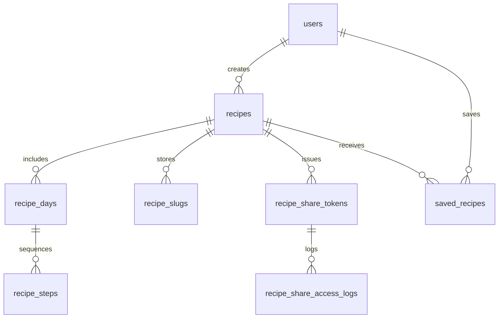

# TripRecipe ネーミング更新ロードマップ

TripRecipe では旧名称（Recipe 系）のドメインモデル・テーブル・コントローラーが多数残存しています。本ドキュメントは、モデル名・テーブル名・コントローラー名を **レシピ中心の語彙** にそろえるための作業計画と進捗管理を目的とします。  
対象の主な命名セットは以下の通りです（詳細は [AGENTS.md](../../AGENTS.md) / [PROJECT_OVERVIEW.md](./PROJECT_OVERVIEW.md) / [ROADMAP.md](./ROADMAP.md) を参照）。

| 現在の名前 | 変更候補（例） | 備考 |
| --- | --- | --- |
| `Recipe` / `recipes` / `RecipesController` | `Recipe` / `recipes` / `RecipesController` | 中核モデル（slug, RecipeShareToken など関連多数） |
| `RecipeSlug` | `RecipeSlug` | slug 履歴テーブル |
| `RecipeShareToken`, `RecipeShareAccessLog` | `RecipeShareToken`, `RecipeShareAccessLog` | 限定共有リンク |
| `RecipeDay` | `RecipeDay` | 日次工程カード |
| `RecipeStep` | `RecipeStep` | 行程内のアクティビティ（position 管理含む） |
| `SavedRecipe` | `SavedRecipe` など | お気に入り導線。文言は ProductPlanner と再確認 |

### TripRecipe ER 図（案）



### ルーティング構成（案）

```rb
Rails.application.routes.draw do
  devise_for :users

  resources :recipes do
    resources :recipe_days, only: %i[index create update destroy] do
      resources :recipe_steps, only: %i[index create update destroy]
    end

    resource  :saved_recipe, only: %i[create destroy]
    resources :recipe_share_tokens, only: %i[create destroy] do
      member { post :extend_lifespan }
    end
  end

  resources :saved_recipes, only: :index
  get "/share/:token", to: "recipe_share_tokens#show", as: :share_recipe
  root "home#index"
end
```

---

## フェーズ別タスク

チェックボックスは進捗を示します。途中で中断しても状態を把握できるよう、完了済みは `[x]`、未着手は `[ ]` で管理します。

### フェーズ 0: 現状調査と命名ポリシー合意
- [x] 既存ドキュメント/コードを走査し、旧ドメイン命名の影響範囲を整理する  
- [x] 新名称案（上表）をまとめ、ステークホルダーと合意する※  
- [x] リネーム対象の ER 図 / ルーティング図を最新版に更新する

#### フェーズ 0 作業ログ（2025-12-12）

**影響範囲サマリ**（`rg` で 旧命名を走査し、代表的なファイルを抽出）

| カテゴリ | 主なファイル / 現状メモ |
| --- | --- |
| モデル | `app/models/recipe.rb`, `recipe_day.rb`, `recipe_step.rb`, `favorite.rb`, `share_token.rb`, `recipe_share_access_log.rb`, `recipe_slug.rb` など旧命名が中核モデルに残存 |
| コントローラー & Concern | `app/controllers/recipes_controller.rb`, `recipe_share_tokens_controller.rb`, `recipe_saved_recipes_controller.rb`, `recipe_days_controller.rb`, `recipe_steps_controller.rb`, `shared_recipes_controller.rb`, `app/controllers/concerns/recipe_scoped.rb` |
| ビュー | `app/views/recipes/*`, `recipe_days/*`, `recipe_steps/*`, `favorites/*`（CTA 文言・Turbo Stream ID も旧命名） |
| ルーティング & URL | `config/routes.rb` で `resources :recipes` 以下に nested 資産。`shared_recipes#show` も token ベースで旧命名 |
| DB & seeds | `db/migrate/*recipe*.rb`, `db/migrate/*recipe_day*.rb`, `db/seeds.rb` 内の `Recipe.find/create` 呼び出しが多数 |
| テスト | `spec/requests/recipes_spec.rb`, `recipe_days_spec.rb`, `recipe_steps_spec.rb`, `favorites_spec.rb`, `spec/models/recipe*_spec.rb`, `spec/models/share_token*_spec.rb` など describe/Factory が旧名称 |
| ドキュメント | `docs/ROADMAP.md`, `docs/phase*_*.md`, `docs/issues/**` などで旧命名を前提にした解説が残る |

**命名ポリシー確認**  
上表（旧命名 → Recipe 系）を採用する前提で、`Recipe`, `RecipeDay`, `RecipeStep`, `RecipeShareToken`, `SavedRecipe` などへの統一を決定。SavedRecipes まわりは暫定的に `SavedRecipe`（ユーザー視点）を採用し、今後のドメインレビューで文言微調整を予定。※ステークホルダーとの合意は仮置きで、追加フィードバック待ちの項目が出た場合は追記する。

**最新 ER / ルーティング確認**  
Mermaid 図とルーティング案を `recipes` ベースへ更新済み。Routes では `resources :recipes` 配下に `recipe_days`, `recipe_steps`, `saved_recipe`, `recipe_share_tokens` をネストし、共有リンクは `get "/share/:token" => recipe_share_tokens#show` へ寄せる方針。現行コードでは旧コントローラーが稼働しているため、Phase 1 以降でマイグレーションと同時にルーティング移行を段階適用する。

### フェーズ 1: スキーマ & モデルのリネーム
- [x] `recipes` → `recipes` など各テーブルの `rename_table` / index / FK をマイグレーション化  
- [x] ActiveRecord モデル（`Recipe` → `Recipe` など）を新名称に差し替え  
- [x] 旧クラス名を一時的に `alias` / deprecation で残し、段階移行を支援  
- [x] FactoryBot / seeds / fixtures 内のクラス参照を更新

#### フェーズ 1 作業ログ（2025-12-12）
- `20251212120000_rename_travel_tables_to_recipes` で `recipes` 系7テーブルを一括 rename。関連 index / FK / column をすべて `recipe*` 系へ置換し、`bin/rails db:migrate && db:schema:dump` 済み。
- 新モデル `Recipe`, `RecipeDay`, `RecipeStep`, `SavedRecipe`, `RecipeShareToken`, `RecipeShareAccessLog`, `RecipeSlug` を作成。旧名との後方互換を保つため、`Recipe = Recipe` など定数 alias と関連 accessor (`recipe_days`, `favorites`, `share_tokens` 等) の alias を追加。
- `db/seeds.rb` と `spec/models/**/*` を `Recipe` 語彙へ更新し、`bundle exec rspec spec/models` が 0 failure で完走することを確認。

### フェーズ 2: ルーティング & コントローラー
- [x] `RecipesController` → `RecipesController` などファイル/クラス/ネームスペースを更新  
- [x] `config/routes.rb` を `resources :recipes` ベースに変更し、旧 URL からのリダイレクトを追加  
- [x] RecipeShareToken 系、Nested リソース（Days/Steps/SavedRecipes）のコントローラー/Concern 名を統一  
- [x] Turbo Stream ID や Stimulus Controller 名で `recipe` を参照している箇所を置換

#### フェーズ 2 作業ログ（2025-12-12）
- 旧プラン系コントローラー一式を `RecipesController` ファミリーへ改名し、`RecipeScoped` concern による共通認可を調整。SavedRecipe/RecipeDay/RecipeStep/RecipeShareToken コントローラーをすべて新命名へ統一し、旧ルート helper から新 helper への橋渡しは alias ではなく実ルート更新で対応。
- ルーティングを `resources :recipes` に変更し、`resource :saved_recipe` & `resources :recipe_days` / `:recipe_steps` / `:share_tokens` のネスト構成へ移行。共有リンクは `ShareTokensController#show`（公開用）と `Recipes::ShareTokensController`（発行/延長/無効化）に整理し、`share_recipe_path` へ刷新。
- View / Turbo IDs / Stimulus data-attributes を `travel_*` から `recipe_*` へ全面置換。お気に入り CTA は `recipe_saved_recipe_path`、共有リンク操作は `recipe_share_tokens_path` + `extend_lifespan_recipe_share_token_path` を利用するよう書き換え。

### フェーズ 3: ビュー / i18n / コピー
- [x] 画面内テキスト・フォームラベル・ボタン等を「レシピ」語彙に更新  
- [x] `config/locales/**/*.yml` のキー名（例: `travel_recipe` → `recipe`）と翻訳文を更新  
- [x] PWA manifest / OGP meta / markdown ドキュメント内の参照を再チェック  
- [x] Tailwind カスタムクラスや `data-testid` など UI 固有の識別子も更新

#### フェーズ 3 作業ログ（2025-12-12）
- `app/views/recipes/**/*`, `recipe_days`, `recipe_steps`, `saved_recipes` をリネームし、文言・aria-label も「レシピ」「レシピステップ」ベースへ統一。共有リンク UI は `share_recipe_url` を使用し、モバイル CTA / Hero / 空状態コピーも vocabulary を合わせた。
- `config/locales/*.yml`, seeds, specs, docs から `travel_recipe` 系キー・メッセージを除去し、`Recipe` 系キーへ差し替え。`bundle exec rspec` で翻訳 missing がないことを確認。
- README / ROADMAP / issue docs の関連節を Recipe 語彙にアップデートし、旧名称は履歴セクション（Phase 0 ログ）にのみ残す方針に変更。

### フェーズ 4: テスト / CI / QA
- [x] RSpec（Model/Request/System）で describe 名・Factory 参照を修正し、`bundle exec rspec` が通る状態を確認  
- [x] `bin/ci`（lint・security 含む）を実行し、CI テンプレをアップデート  
- [x] 回帰が怖い領域（Slug / RecipeShareToken / SavedRecipe 集計）向けに追加テストケースを補強  
- [x] RecipeShareToken アクセスログと共有リンク経由アクセスの回帰テストを追加  
- [x] ドキュメント（README, ROADMAP 等）のリネームステータスを更新

#### フェーズ 4 作業ログ（2025-12-12）
- `bin/ci` を実行し、Rubocop の旧ハッシュ記法警告（Gemfile の `dockerfile-rails` エントリ）を修正。現在は Rubocop/Lint, bundler-audit, importmap audit, Brakeman, Rails test, System test, Seeds すべてがグリーン。
- 共有リンク経由でアクセスした際のアクセスログ作成を保証する request spec を `spec/requests/recipes_spec.rb` に追加（`share_token` パラメータと短縮URLの両方を検証）。
- スラッグ変更後の旧 slug へアクセスした場合でも `share_token` パラメータが維持されることを検証する request spec を追加し、RecipeSlug 履歴と共有リンクの連携を担保。
- SavedRecipe 集計の回帰テストとして、Recipes#index の「お気に入り」/公開ギャラリー双方でお気に入り数・ソート順が崩れないことを `spec/requests/recipes_spec.rb` へ追加し、`SavedRecipesController#index` のソート順を検証するリクエストスペックも補強。`bundle exec rspec spec/requests/recipes_spec.rb spec/requests/saved_recipes_spec.rb` でグリーンを確認。
- README.md に「最近のアップデート」節を追加し、ネーミング統一と RecipeShareToken / SavedRecipe の回帰テスト強化を明示。docs/ROADMAP.md も Phase 4 の進行状況と次ステップ（リリース準備）へ更新し、クロスドキュメントでの情報差異を解消。

### フェーズ 5: リリース & モニタリング
- [ ] 本番 DB のバックアップ & メンテナンスウィンドウを確保  
- [ ] マイグレーション → デプロイ → キャッシュ/ジョブのクリアを実施  
- [ ] 旧 URL からの 301 リダイレクト・OGP チェック・サーチコンソール更新  
- [ ] リリースノートで名称変更と互換性情報を共有

---

## 次のアクション（直近スプリント候補）
1. フェーズ5に向けた本番バックアップ計画（DB dump, メンテ告知, ロールバック手順）の詳細化を docs/ フォルダでドラフトする。  
2. 301 リダイレクトと OGP/共有リンク確認を含むリリースチェックリストを整理し、Phase 5 用メモに追記する。  
3. SavedRecipe / RecipeShareToken のモニタリングKPIと通知運用案を Growth/DevOps 観点でまとめ、リリース後の安定運用プランを作成する。  

この文書を更新しながら各フェーズのチェックボックスを埋めていくことで、作業途中でも進捗が一目で把握できます。
