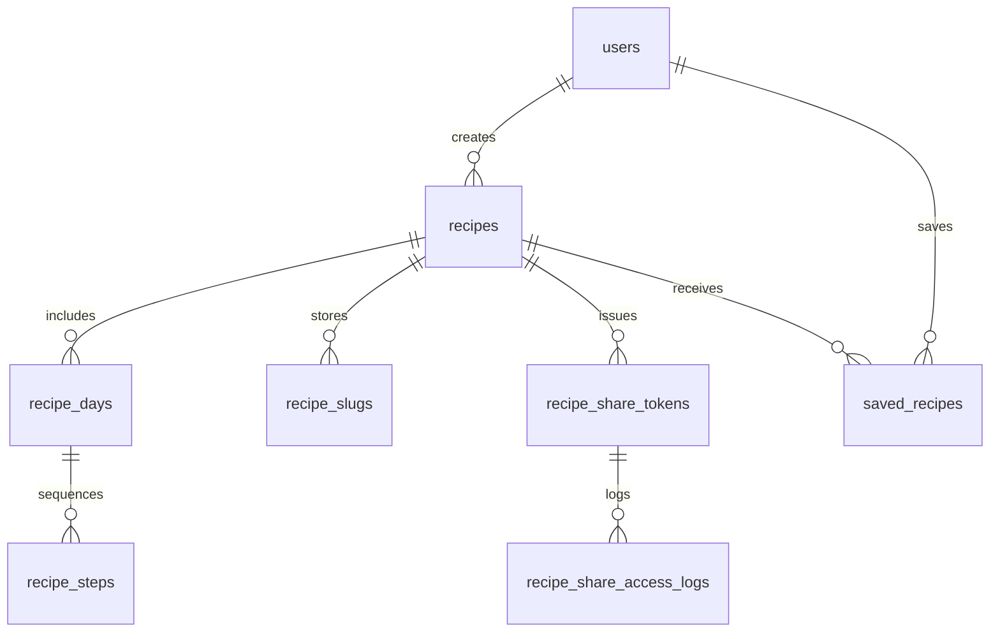

# TripRecipe ネーミング更新ロードマップ

TripRecipe では旧名称（Recipe 系）のドメインモデル・テーブル・コントローラーが多数残存しています。本ドキュメントは、モデル名・テーブル名・コントローラー名を **レシピ中心の語彙** にそろえるための作業計画と進捗管理を目的とします。  
対象の主な命名セットは以下の通りです（詳細は [AGENTS.md](../../AGENTS.md) / [PROJECT_OVERVIEW.md](../architecture/PROJECT_OVERVIEW.md) / [ROADMAP.md](./ROADMAP.md) を参照）。

| 現在の名前 | 変更候補（例） | 備考 |
| --- | --- | --- |
| `Recipe` / `recipes` / `RecipesController` | `Recipe` / `recipes` / `RecipesController` | 中核モデル（slug, RecipeShareToken など関連多数） |
| `RecipeSlug` | `RecipeSlug` | slug 履歴テーブル |
| `RecipeShareToken`, `RecipeShareAccessLog` | `RecipeShareToken`, `RecipeShareAccessLog` | 限定共有リンク |
| `RecipeDay` | `RecipeDay` | 日次工程カード |
| `RecipeStep` | `RecipeStep` | 行程内のアクティビティ（position 管理含む） |
| `SavedRecipe` | `SavedRecipe` など | お気に入り導線。文言は ProductPlanner と再確認 |

### TripRecipe ER 図（案）



### ルーティング構成（案）

```rb
Rails.application.routes.draw do
  devise_for :users

  resources :recipes do
    resources :recipe_days, only: %i[index create update destroy] do
      resources :recipe_steps, only: %i[index create update destroy]
    end

    resource  :saved_recipe, only: %i[create destroy]
    resources :recipe_share_tokens, only: %i[create destroy] do
      member { post :extend_lifespan }
    end
  end

  resources :saved_recipes, only: :index
  get "/share/:token", to: "recipe_share_tokens#show", as: :share_recipe
  root "home#index"
end
```

---

## フェーズ別タスク

チェックボックスは進捗を示します。途中で中断しても状態を把握できるよう、完了済みは `[x]`、未着手は `[ ]` で管理します。

### フェーズ 0: 現状調査と命名ポリシー合意
- [x] 既存ドキュメント/コードを走査し、旧ドメイン命名の影響範囲を整理する  
- [x] 新名称案（上表）をまとめ、ステークホルダーと合意する※  
- [x] リネーム対象の ER 図 / ルーティング図を最新版に更新する

...（略・元の内容を保持）
